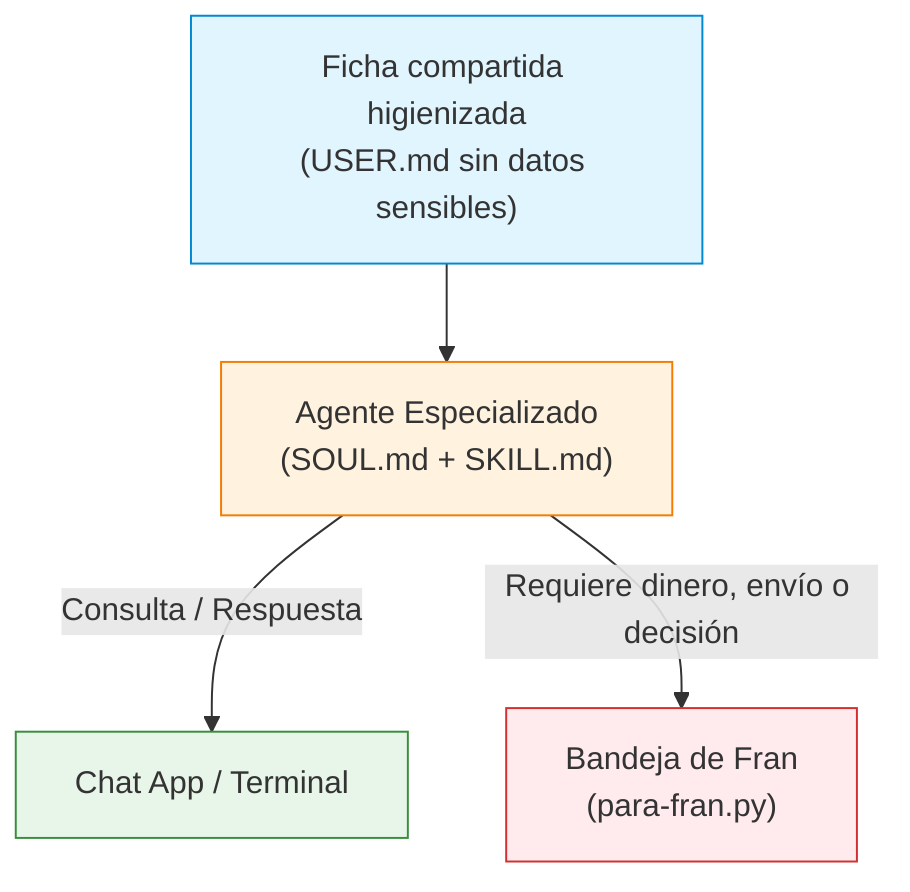

# Los agentes de un solo oficio (montados el 2026-10-12)

Cada agente es un especialista configurado para resolver **un único cometido**, siguiendo la misma arquitectura base descrita en [Zazu Viajes](file:///home/server/Escritorio/Spirit/docs/aprender/primer-agente-viajes.md). 

Viven de forma aislada en `~/.hermes/profiles/<perfil>/` (accesibles directamente en el repositorio en [hermes/ajustes/profiles/](file:///home/server/Escritorio/Spirit/hermes/ajustes/profiles)):
* **Identidad y límites:** `SOUL.md` (misión concreta y restricciones infranqueables).
* **Pasos y formato:** `skills/productivity/<habilidad>/SKILL.md`.
* **Herramientas y modelo:** `config.yaml`.
* **Credenciales mínimas:** `.env` (únicamente con la clave de Anthropic, sin accesos extras).
* **Seguridad:** Hook de permisos activo en todos ellos.

En la aplicación aparecen como **chips directos** en la pestaña Chat.



---

## 1. Resumen de agentes

| Chip | Perfil | Modelo | Misión principal | Estado |
|---|---|---|---|---|
| **Viajes** | [`viajes`](file:///home/server/Escritorio/Spirit/hermes/ajustes/profiles/viajes) | Sonnet 5.5 | Itinerarios completos, vuelos, estancias y presupuestos | Activo |
| **Empleo** | [`empleo`](file:///home/server/Escritorio/Spirit/hermes/ajustes/profiles/empleo) | Sonnet 5.5 | Encaje de ofertas, cartas personalizadas y tablero | Activo |
| **Teórico** | [`teorico`](file:///home/server/Escritorio/Spirit/hermes/ajustes/profiles/teorico) | Haiku 5.5 | Tests de 10 preguntas DGT, corrección y racha | Activo |
| **Comidas** | [`comidas`](file:///home/server/Escritorio/Spirit/hermes/ajustes/profiles/comidas) | Haiku 5.5 | Menú semanal planificado y lista de la compra | Activo |
| **Dinero** | [`dinero`](file:///home/server/Escritorio/Spirit/hermes/ajustes/profiles/dinero) | Haiku 5.5 | Control de gastos, suscripciones y reclamaciones | Activo |
| **Papeles** | [`papeles`](file:///home/server/Escritorio/Spirit/hermes/ajustes/profiles/papeles) | Haiku 5.5 | Vencimientos (DNI, ITV), trámites y requisitos | Activo |
| **Compras** | [`compras`](file:///home/server/Escritorio/Spirit/hermes/ajustes/profiles/compras) | Sonnet 5.5 | Comparativas 3 opciones, precios y fiabilidad de webs | Activo |
| **Salud** | [`salud`](file:///home/server/Escritorio/Spirit/hermes/ajustes/profiles/salud) | Haiku 5.5 | Calendario de citas, pautas y guion para el médico | Activo |
| **Profe** | [`profe`](file:///home/server/Escritorio/Spirit/hermes/ajustes/profiles/profe) | Sonnet 5.5 | Tutor de código Spirit y seguimiento de plan de estudios | Activo |
| **Analista** | [`analista`](file:///home/server/Escritorio/Spirit/hermes/ajustes/profiles/analista) | Sonnet 5.5 | Auditoría de código, apps y webs con REA | Activo |
| **Casa** | `casa` | — | Automatización domótica (luces, enchufes) | En espera (Home Assistant) |

---

## 2. Fichas detalladas de los agentes

### 🧳 Viajes
* **Perfil:** [`viajes`](file:///home/server/Escritorio/Spirit/hermes/ajustes/profiles/viajes) · **Modelo:** Sonnet 5.5
* **Habilidad principal:** `planificar-viaje`
* **Oficio:** Buscar, comparar y estructurar itinerarios diarios con transportes, alojamientos y estimación de costes.
* **Límite:** No reserva, no compra ni gestiona pagos.
* **Herramientas:** Navegador web (`browser`), búsquedas (`web`), memoria.
* **Ejemplo rápido:**
  ```bash
  hermes -p viajes -z "Plan de 3 días en Lisboa en noviembre, dos personas, presupuesto medio"
  ```

### 💼 Empleo
* **Perfil:** [`empleo`](file:///home/server/Escritorio/Spirit/hermes/ajustes/profiles/empleo) · **Modelo:** Sonnet 5.5
* **Habilidades:** `preparar-candidatura`, `ofertas-y-candidaturas`
* **Oficio:** Analizar encaje con vacantes, redactar cartas en tu propio tono, preparar entrevistas y gestionar ofertas/tablero.
* **Límite:** Nunca se inscribe, no envía correos ni inventa datos ausentes en tu CV.
* **Herramientas:** `web`, `browser`, `mis_documentos.py`, `guardar_carta.py`, `mis_ofertas.py`, `candidatura_nueva.py`, `portales.md`.
* **Ejemplo rápido:**
  ```bash
  hermes -p empleo -z "Analiza esta vacante y dime mi porcentaje de encaje y puntos a reforzar"
  ```

### 🚗 Profe del teórico
* **Perfil:** [`teorico`](file:///home/server/Escritorio/Spirit/hermes/ajustes/profiles/teorico) · **Modelo:** Haiku 5.5
* **Habilidad principal:** `test-teorico`
* **Oficio:** Tests de 10 preguntas tipo DGT, corrección razonada y control de racha de estudio.
* **Límite:** Solo estudio; si duda de una cifra legal exacta, lo advierte expresamente.
* **Herramientas:** Memoria, terminal (únicamente para avisar a Fran).
* **Ejemplo rápido:**
  ```bash
  hermes -p teorico -z "Ponme un test de 10 preguntas sobre prioridades de paso y glorietas"
  ```

### 🥗 Comidas y compra
* **Perfil:** [`comidas`](file:///home/server/Escritorio/Spirit/hermes/ajustes/profiles/comidas) · **Modelo:** Haiku 5.5
* **Habilidad principal:** `menu-y-compra`
* **Oficio:** Planificar menús semanales equilibrados y confeccionar la lista de la compra para la despensa.
* **Límite:** No tramita compras online ni pedidos a domicilio.
* **Herramientas:** `casa.py` (ver/compra), memoria.
* **Ejemplo rápido:**
  ```bash
  hermes -p comidas -z "Genera el menú de comidas de lunes a viernes y añade los ingredientes a la lista de compra"
  ```

### 💳 Dinero
* **Perfil:** [`dinero`](file:///home/server/Escritorio/Spirit/hermes/ajustes/profiles/dinero) · **Modelo:** Haiku 5.5
* **Habilidad principal:** `revisar-gastos`
* **Oficio:** Resumen de gastos del mes, detección de suscripciones prescindibles y redacción de borradores de baja o reclamación.
* **Límite:** Nunca efectúa pagos ni cancelaciones; no maneja números de cuenta ni tarjetas completas.
* **Herramientas:** `zv gastos`, `zv suscripciones`, memoria.
* **Ejemplo rápido:**
  ```bash
  hermes -p dinero -z "¿Qué suscripciones recurrentes tengo registradas este mes?"
  ```

### 📑 Papeles
* **Perfil:** [`papeles`](file:///home/server/Escritorio/Spirit/hermes/ajustes/profiles/papeles) · **Modelo:** Haiku 5.5
* **Habilidad principal:** `papeles-y-tramites`
* **Oficio:** Recordar fechas de caducidad (DNI, ITV, seguros), trámites requeridos y documentación necesaria.
* **Límite:** No rellena formularios oficiales ni gestiona identidades digitales.
* **Herramientas:** `papeles_estado.py` (solo nombres y fechas, con filtro estricto de privacidad), memoria.
* **Ejemplo rápido:**
  ```bash
  hermes -p papeles -z "¿Qué trámites o documentos vencen en los próximos dos meses?"
  ```

### 🛍️ Compras
* **Perfil:** [`compras`](file:///home/server/Escritorio/Spirit/hermes/ajustes/profiles/compras) · **Modelo:** Sonnet 5.5
* **Habilidades:** `comparar-compra`, `comprobar-enlace`
* **Oficio:** Proponer 3 opciones contrastadas (precio, tienda, pegas), monitorizar precios y auditar si un enlace/tienda es seguro (antigüedad de dominio, titular, opiniones).
* **Límite:** No compra ni se registra en las plataformas que audita.
* **Herramientas:** `web`, `browser`, memoria, `comprobar_enlace.py` (sin IA).
* **Ejemplo rápido:**
  ```bash
  hermes -p compras -z "¿Es de fiar este enlace para comprar unas zapatillas? https://..."
  ```

### 🩺 Salud
* **Perfil:** [`salud`](file:///home/server/Escritorio/Spirit/hermes/ajustes/profiles/salud) · **Modelo:** Haiku 5.5
* **Habilidad principal:** `organizar-salud`
* **Oficio:** Organización de citas médicas, pautas de medicación y redacción de guiones para preparar consultas.
* **Límite:** No emite diagnósticos ni prescribe; ante emergencias redirige al 112; no lee correos ni documentos privados.
* **Herramientas:** Memoria aislada propia (no sincronizada), terminal (solo para avisos).
* **Ejemplo rápido:**
  ```bash
  hermes -p salud -z "Ayúdame a preparar las preguntas y dudas para mi revisión médica del viernes"
  ```

### 🎓 Profe de Spirit
* **Perfil:** [`profe`](file:///home/server/Escritorio/Spirit/hermes/ajustes/profiles/profe) · **Modelo:** Sonnet 5.5
* **Habilidades:** `explicar-spirit`, `plan-de-estudios`
* **Oficio:** Explicar el código de Spirit por bloques, proponer ejercicios y guiar el [plan de estudios de Fran](file:///home/server/Escritorio/Spirit/docs/aprender/plan-de-fran.md).
* **Límite:** Solo lee dentro de `~/Spirit`; solo escribe en su propio archivo de seguimiento.
* **Herramientas:** Terminal (solo lectura), memoria.
* **Ejemplo rápido:**
  ```bash
  hermes -p profe -z "Qué toca hoy en mi plan de estudios"
  ```

### 🔍 Analista
* **Perfil:** [`analista`](file:///home/server/Escritorio/Spirit/hermes/ajustes/profiles/analista) · **Modelo:** Sonnet 5.5
* **Habilidad principal:** `analizar-con-rea`
* **Oficio:** Inspección profunda de código, aplicaciones y páginas web (arquitectura, llamadas de red, permisos y pseudocódigo).
* **Límite:** Solo lectura; no elude protecciones ni licencias; analiza exclusivamente código de Fran o fuentes públicas.
* **Herramientas:** REA (servidor MCP), `web`, terminal, memoria.
* **Ejemplo rápido:**
  ```bash
  hermes -p analista -z "Analiza este script y detalla qué llamadas de red o accesos a disco realiza"
  ```

---

## 3. Patrones compartidos por todos los agentes

> [!NOTE]
> Ideas tomadas de *tuasistenteconia.es* (2026-10-12).

1. **Ficha de Fran compartida (higienizada):**
   * El archivo [ficha-de-fran.md](file:///home/server/Escritorio/Spirit/hermes/ajustes/ficha-de-fran.md) es una copia del `USER.md` de Zazu **sin datos confidenciales** (correos, teléfonos y cuentas se omiten).
   * Todos los asistentes la vinculan como su propio `USER.md`, excepto **Salud**, que mantiene su contexto totalmente aislado.
   * Se actualiza automáticamente ejecutando:
     ```bash
     python3 ~/Spirit/zazu/scripts/ficha-de-fran.py
     ```
2. **«Déjale un mensaje a Fran»:**
   * Cuando un asistente requiere una autorización o acción del usuario (pagar, confirmar un trámite o tomar una decisión), deposita una tarjeta en tu bandeja:
     ```bash
     python3 ~/.hermes/scripts/para-fran.py "Título" "Detalle" --de <oficio>
     ```
   * En la app web aparece en **Zazu › Avisos** con las opciones *Hecho / Luego / Descartar* y emite una notificación. Límite: un aviso por asunto y día para evitar spam.

---

## 4. Regla de Dos y Seguridad

> [!IMPORTANT]
> **La Regla de Dos:**
> 1. Ningún agente dispone de acceso a cuentas personales (Google, WhatsApp) ni a archivos locales, salvo lo estrictamente indispensable para su cometido.
> 2. Los agentes que consumen datos del exterior (webs, ofertas de empleo) tienen el canal de envío bloqueado. Los perfiles sensibles (Papeles, Salud) únicamente manipulan nombres y fechas, jamás contenidos completos ni datos bancarios.

---

## 5. Operaciones y mantenimiento

### Cómo interactuar con ellos
* **En la aplicación web:** En el **Chat**, pulsa sobre el chip del asistente deseado (o accede desde *Más › Asistentes*).
* **Por consola (pregunta directa):**
  ```bash
  hermes -p <perfil> -z "Tu consulta aquí"
  ```
* **Por consola (sesión interactiva):**
  ```bash
  hermes -p <perfil>
  ```

### Cómo modificar su comportamiento
* **Personalidad y límites:** Modifica su archivo `SOUL.md`.
* **Procedimientos y formato:** Ajusta su habilidad en `skills/productivity/<habilidad>/SKILL.md`.
* **Herramientas y modelo:** Edita su `config.yaml` (`platform_toolsets`, `model.default`).
* **Memoria persistente:** Pídeselo en la charla (*«recuerda que...»*) o edita manualmente su carpeta `memories/`.

### Comandos útiles de mantenimiento

| Tarea | Comando |
|---|---|
| **Regenerar ficha compartida** | `python3 ~/Spirit/zazu/scripts/ficha-de-fran.py` |
| **Verificar permisos y hooks** | `hermes -p <perfil> hooks doctor` |
| **Abaratar costes (pasar a Haiku)** | `hermes -p <perfil> config set model.default claude-haiku-5-5` |
| **Subir capacidad (pasar a Sonnet)** | `hermes -p <perfil> config set model.default claude-sonnet-5-5` |
| **Medir consumo de una consulta** | `hermes -p <perfil> --usage-file /tmp/uso.json -z "..." && cat /tmp/uso.json` |
